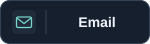
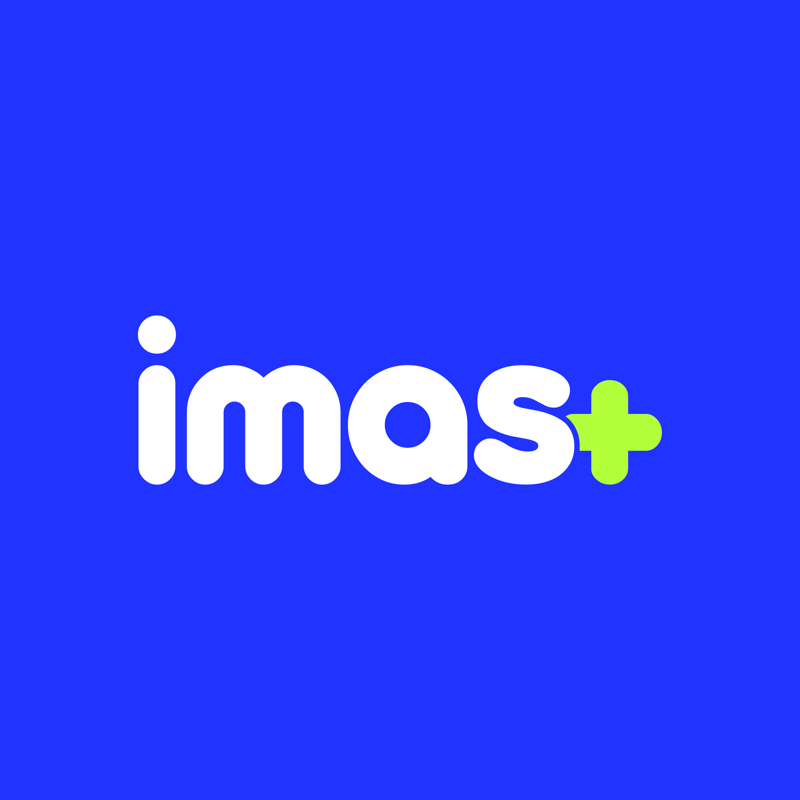
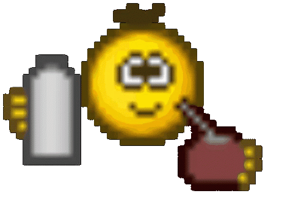

<!-- Nicolas Giordano: character-based typography, not an image. -->
<pre align="center">
┏┓╻╻┏━╸┏━┓╻  ┏━┓┏━┓   ┏━╸╻┏━┓┏━┓╺┳┓┏━┓┏┓╻┏━┓
┃┗┫┃┃  ┃ ┃┃  ┣━┫┗━┓   ┃╺┓┃┃ ┃┣┳┛ ┃┃┣━┫┃┗┫┃ ┃
╹ ╹╹┗━╸┗━┛┗━╸╹ ╹┗━┛   ┗━┛╹┗━┛╹┗╸╺┻┛╹ ╹╹ ╹┗━┛
</pre>

<p align="center"><samp>COMPUTER ENGINEERING @ UADE · SOFTWARE DEVELOPMENT</samp></p>

<p align="center">
  I'm a Computer Engineering student at <strong>Universidad Argentina de la Empresa (UADE)</strong>, focused on building web applications and exploring software systems.<br />
  My projects bring together frontend development, backend APIs, databases, and experiments with neural simulation.
</p>

<p align="center">
  I also founded <strong>imas+</strong>, UADE's Computer Science Club.
</p>

<p align="center">
  
</p>

<p align="center">
  <a href="#-whoami">About me</a> · <a href="#-connect">Connect</a> · <a href="#-projects">Projects</a> · <a href="#-community">imas+</a>
</p>

## `> whoami`

```typescript
const nico = {
  name: "Nicolás Luca Giordano",
  basedIn: "Buenos Aires, Argentina",
  education: {
    studying: "Computer Engineering @ UADE",
    qualification: "Analista en Informática",
    qualificationYear: 2026,
  },
  community: { founder: "imas+ — UADE" },
  building: ["Web applications", "Backend APIs"],
  exploring: ["Software architecture", "Neural simulation"],
  also: "Graphic design & visual identity",
};
```

## `> connect`

<p align="center"><strong>Connect with me</strong></p>

<p align="center">
  <a href="https://www.linkedin.com/in/nicol%C3%A1s-giordano/"></a>
  &nbsp;&nbsp;
  <a href="mailto:nicolasgiordano1505@gmail.com"></a>
</p>

<p align="center">
  <samp><a href="mailto:nicolasgiordano1505@gmail.com">nicolasgiordano1505@gmail.com</a></samp>
</p>

## `> community`

<table>
  <tr>
    <td width="190" align="center">
      
    </td>
    <td>
      <h3>Founder of imas+</h3>
      <p><strong>UADE's Computer Science Club</strong></p>
      <p>I founded imas+, bringing my interest in technology and community together at UADE.</p>
      <p>A space for students to connect around computing, share what they learn, and build together.</p>
    </td>
  </tr>
</table>

## `> projects`

<table>
  <thead>
    <tr>
      <th align="left">Project</th>
      <th align="left">Overview</th>
    </tr>
  </thead>
  <tbody>
    <tr>
      <td valign="top" width="25%"><strong>🎓 <a href="https://github.com/nicogiorda/Kreis">Kreis</a></strong></td>
      <td>
        <p>A mobile-first app where university students discover events and join communities around shared interests.</p>
        <p><strong>Frontend Lead &amp; Branding</strong> — frontend development, interfaces, and visual identity, with backend contributions. Built with an eight-person team.</p>
        <code>React</code> <code>TypeScript</code> <code>Vite</code> <code>Node.js</code> <code>Prisma</code> <code>PostgreSQL</code>
      </td>
    </tr>
    <tr>
      <td valign="top"><strong>🪰 <a href="https://github.com/Matias-Sanmiguel/fly-crossy-connectome">fly-crossy-connectome</a></strong></td>
      <td>
        <p>A 3D Crossy Road-style browser experiment where a reduced fly connectome drives autonomous gameplay, alongside a live view of simulated neural activity.</p>
        <p><strong>Contributor</strong> — collaboration on a project bringing together browser games, software, and neural simulation.</p>
        <code>TypeScript</code> <code>Python</code> <code>Docker</code>
      </td>
    </tr>
  </tbody>
</table>

## `> toolbox`

<div align="center">

<p align="center">Languages, tools, and platforms I use across my projects.</p>

<table align="center">
  <tr>
    <td align="center" valign="top" width="50%">
      <strong>Languages</strong><br /><br />
      
    </td>
    <td align="center" valign="top" width="50%">
      <strong>Frameworks &amp; runtimes</strong><br /><br />
      
    </td>
  </tr>
  <tr>
    <td align="center" valign="top" width="50%">
      <strong>Databases &amp; ORM</strong><br /><br />
      
    </td>
    <td align="center" valign="top" width="50%">
      <strong>Deployment</strong><br /><br />
      
      
    </td>
  </tr>
  <tr>
    <td align="center" valign="top" width="50%">
      <strong>Version control</strong><br /><br />
      
    </td>
    <td align="center" valign="top" width="50%">
      <strong>Design</strong><br /><br />
      
    </td>
  </tr>
</table>

</div>

---

<p align="center">
  <a href="https://tenor.com/view/emoji-mate-mate-mates-emoji-tomando-mates-emoji-tomando-mate-gif-5995996843990285223"></a><br />
  <samp>turning &ldquo;what if?&rdquo; into projects.</samp>
</p>

<!-- Mate GIF: MatiasG15 on Tenor, https://tenor.com/view/emoji-mate-mate-mates-emoji-tomando-mates-emoji-tomando-mate-gif-5995996843990285223.
Retro PC animation: TheDudeThatCode/TheDudeThatCode, Assets/PC.gif.
Inspiration: Ileriayo/ileriayo (centered contact badges), Thaiane/Thaiane (code introduction), vinitshahdeo/vinitshahdeo (personal and community sections), hedythedev/hedythedev (terminal-style headings), apoorvtyagi/apoorvtyagi (small animated details and stack icons). Icons: tandpfun/skill-icons, MIT. Render mark: simple-icons/simple-icons, CC0. imas+ artwork supplied by Nicolás Giordano. -->
