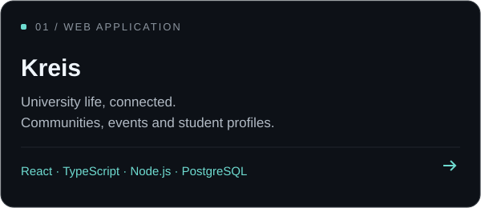
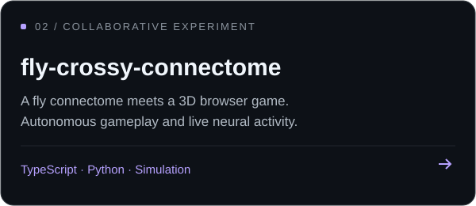

<h1 align="center">Hey, I'm Nico 👋</h1>

  

  I build web applications and explore software through hands-on projects. 
  React interfaces, backend APIs, relational databases — and a curiosity for experiments.

  
   
  <a href="https://www.linkedin.com/in/nicol%C3%A1s-giordano/">Let's connect on LinkedIn</a>

## 🛠️ My stack

Technologies I use across my projects.

**Frontend**

**Backend**

**Data & tools**

## 🚀 Selected projects

  
  

**[Kreis](https://github.com/nicogiorda/Kreis)** · A mobile-first PWA for university life, combining a React frontend, a modular Express API, and shared TypeScript contracts.

**[fly-crossy-connectome](https://github.com/Matias-Sanmiguel/fly-crossy-connectome)** · A collaborative Crossy Road-style experiment where a reduced fly connectome drives autonomous gameplay, with a real-time view of simulated neural activity.

---

<a href="https://www.linkedin.com/in/nicol%C3%A1s-giordano/">LinkedIn</a> · <a href="https://github.com/nicogiorda?tab=repositories">Explore my repositories</a>

<!-- Layout inspiration: DenverCoder1/DenverCoder1, discovered through abhisheknaiidu/awesome-github-profile-readme. Stack icons: tandpfun/skill-icons (MIT). Original local GIF and project cards; no banner. -->
